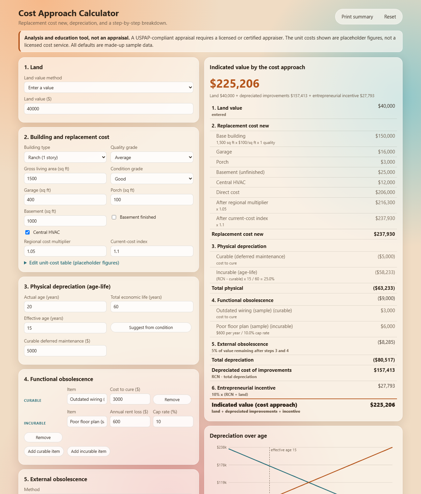

# Cost Approach Calculator

[](https://github.com/chasebuilds/cost-approach-calculator/actions/workflows/ci.yml)

**Live demo: https://chasebuilds.github.io/cost-approach-calculator/**

**Enter a building, get a documented cost-approach value.** Every step is shown, from replacement cost new through each kind of depreciation to the indicated value, with a depreciation chart and a one-page print summary. Save a scenario as JSON, export the breakdown as CSV, or share it as a link. It runs in the browser; nothing is uploaded.

> **This is an analysis and education tool, not an appraisal.** A USPAP-compliant appraisal requires a licensed or certified appraiser. The unit costs that ship with the app are **made-up placeholder figures**, not a licensed cost service. All default data is synthetic.



## What it does

1. **Land**: enter a value, or enter land comps (price and lot size) and use the median $/sq ft times the subject lot.
2. **Replacement cost new**: base cost per sq ft by building type and quality grade, plus garage, porch, basement (finished or not) and central HVAC, then a regional multiplier and a current-cost index. Optional indirect costs. The unit-cost table is shown in the page and editable.
3. **Physical depreciation**: age-life method (effective age / total economic life), split into curable (deferred maintenance at cost to cure) and incurable (the rest, depreciated by the age-life rate). A condition grade can suggest an effective age.
4. **Functional obsolescence**: entered items. Curable items use cost to cure. Incurable items capitalize a yearly rent loss at a cap rate.
5. **External obsolescence**: an entered percent of the value remaining, or paired-rent capitalization (monthly rent difference x 12 / cap rate).
6. **Entrepreneurial incentive**: a percent of (replacement cost new + land).
7. **Market check**: extract the depreciation one improved sale implies (sale price less land, against its cost new) and compare it with this estimate in percentage points.
8. A step-by-step breakdown, a chart of depreciation over age with remaining economic life, and a print layout that fits one page.
9. **Save and share**: scenario JSON (save and load, with the edited cost table), CSV of the breakdown, and a share link that carries the whole scenario in the URL hash.

## Formulas

| Step | Formula |
|---|---|
| Replacement cost new | `(GLA x base $/sf x quality + features) x regional x index`, plus indirect costs |
| Age-life rate | `min(1, effective age / total economic life)` |
| Curable physical | `min(cost to cure, RCN)` |
| Incurable physical | `(RCN - curable) x age-life rate` |
| Functional, incurable item | `annual loss / cap rate` |
| External, percent | `pct x (RCN - physical - functional)` |
| External, paired rent | `min(remaining, (rent without - rent with) x 12 / cap rate)` |
| Entrepreneurial incentive | `pct x (RCN + land)`, added after depreciation, not depreciated |
| Extracted depreciation | `(RCN - (sale price - land)) / RCN` |
| Indicated value | `land + (RCN - total depreciation) + incentive` |

Worked example used in the tests (all hand-checked): ranch, 1,500 sq ft, average quality, features $56,000, x1.05 x1.10 gives RCN $237,930. Effective age 15 of 60 with $5,000 deferred maintenance gives physical $63,232.50. Functional $9,000, external 5% gives $8,284.88. Land $40,000 and 10% incentive give an indicated value of $225,205.63.

## Develop

```bash
npm ci
npm run dev      # local server
npm test         # Vitest, 39 tests
npm run bench    # sweep and timing, see BENCHMARK.md
npm run lint     # ESLint
npm run build    # strict tsc + Vite build into dist/
```

TypeScript strict mode, ESLint (typescript-eslint strict) and the tests run in CI on every push.

## Limitations

- Placeholder unit costs only. Real work needs a licensed cost service or your own local cost data, which you can type into the table.
- One building, one improvement type. No multiple buildings, site improvements, or per-component (segregated) cost lines.
- Age-life is the only physical method. No breakdown or observed-condition method.
- Land comps use a plain median with no adjustments for date, location or size.
- The entrepreneurial incentive treatment (a percent of cost new plus land) is one common convention, not the only one. Market-extracted incentive is not calculated.
- Nothing is stored in the browser. Use Save JSON or the share link to keep a scenario.
- Market extraction uses one sale; real work compares several and adjusts for time and location.
- No USPAP reconciliation with the sales comparison or income approaches.

## Benchmark

See [BENCHMARK.md](BENCHMARK.md): 25,920 swept cases, 0 invariant violations, about 2.96 million estimates per second on the dev machine.

## License

MIT, Chase Builds.

## More from Chase Builds

- **[income-approach-valuation](https://github.com/chasebuilds/income-approach-valuation)**: Income approach for rentals and small commercial: rent roll to NOI, direct cap, band of investment and DCF, reconciled. ([live demo](https://chasebuilds.github.io/income-approach-valuation/))
- **[assessment-ratio-study](https://github.com/chasebuilds/assessment-ratio-study)**: Regressivity, under-assessment and sales chasing caught in 30 of 30 seeded counties. ([live demo](https://chasebuilds.github.io/assessment-ratio-study/))
- **[land-feasibility-3d](https://github.com/chasebuilds/land-feasibility-3d)**: Real USGS terrain in 3D with slope, lot layout, cut and fill, and flood checks, plus a quick pro forma. ([live demo](https://chasebuilds.github.io/land-feasibility-3d/))

[All projects, sorted by industry](https://github.com/chasebuilds) · [chasebuilds.github.io](https://chasebuilds.github.io)
